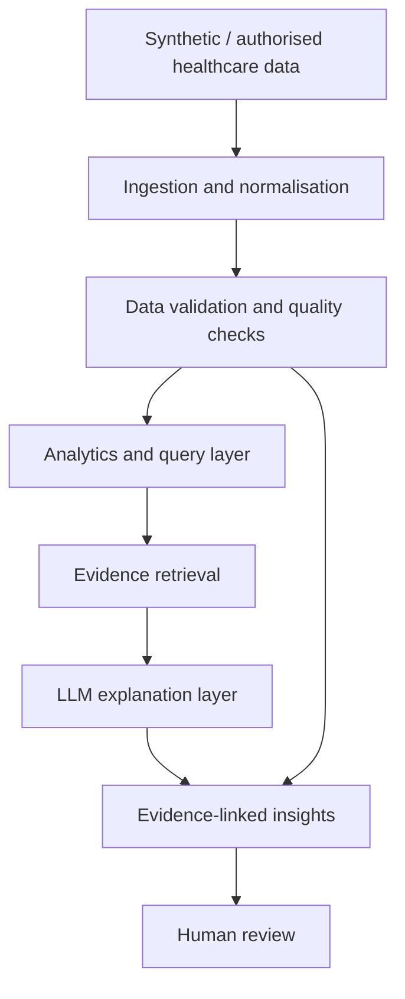

# MedTrace AI

> **Evidence-grounded healthcare intelligence for more trustworthy decisions.**

MedTrace AI is a hackathon prototype for **Challenge 3 — Exasol: Healthcare AI You Can Trust** at Healthcare Hackathon Bayern, Erlangen.

Healthcare information is often fragmented across clinical notes, medication records, laboratory results and other systems. MedTrace AI explores how these records can be brought together to surface useful insights while making supporting evidence, uncertainty and data-quality limitations visible.

**This is an experimental prototype. It is not a medical device, diagnostic system or substitute for professional clinical judgement. Use synthetic or appropriately authorised, de-identified data only.**

## The problem

Healthcare data can be distributed across systems, incomplete, out of date, inconsistent or difficult to interpret. A generic chatbot does not solve these problems. A useful healthcare AI application must show where findings come from, identify gaps and contradictions, and communicate when evidence is insufficient.

## Our approach

MedTrace AI is designed around four principles:

1. **Connect** relevant structured and unstructured healthcare records.
2. **Validate** missing fields, duplicates, conflicting values and temporal inconsistencies.
3. **Explain** findings using retrieved source records and traceable references.
4. **Keep humans in control** by showing evidence and uncertainty for human review.

### Intended demonstration

A user asks:

> "Summarise the available history for this patient. Which records appear inconsistent, and what information is missing?"

The prototype should retrieve relevant records, display source and date, flag data-quality issues, generate an evidence-linked explanation, state what cannot be concluded, and mark the output for human review. It does not generate diagnoses or treatment recommendations.

## Trust and safety principles

| Principle | Prototype behaviour |
|---|---|
| Evidence traceability | Factual findings link to source record IDs. |
| Uncertainty | Insufficient or ambiguous evidence is explicitly reported. |
| Data quality | Missing, duplicate and conflicting records are surfaced. |
| Human oversight | Outputs are informational and require human review. |
| Privacy | Use synthetic or properly authorised, de-identified data only. |
| Separation of concerns | Deterministic checks/calculations run in code or SQL, not delegated to an LLM. |

## Architecture



## Planned technology

| Layer | Initial direction | Possible hackathon extension |
|---|---|---|
| Language | Python | Python |
| Ingestion | CSV / pandas | Additional formats/connectors |
| Storage | SQLite for local prototype | Exasol Personal / team-selected database |
| Validation | Python and SQL rules | More comprehensive quality checks |
| Retrieval | Transparent keyword baseline | Embeddings / vector retrieval |
| AI | Optional LLM API | Team-selected model and orchestration |
| Interface | CLI initially | Streamlit or React |
| Testing | pytest | Scenario-based evaluation |

The stack is intentionally flexible. Exasol Personal is a potential analytics foundation for structured healthcare data; the final integration depends on the team's chosen solution and available access.

## Repository structure

```text
medtrace-ai/
├── data/
│   └── synthetic/       # Fictional demonstration data only
├── docs/                # Architecture and decision notes
├── src/
│   └── medtrace/        # Application source code
├── tests/               # Unit and scenario tests
├── .env.example
├── .gitignore
├── LICENSE
├── README.md
└── requirements.txt
```

## Getting started

### Requirements
- Python 3.11 or 3.12
- Git
- VS Code or another Python IDE

### 1. Clone
```bash
git clone https://github.com/<your-github-username>/medtrace-ai.git
cd medtrace-ai
```

### 2. Create a virtual environment

**Windows PowerShell**
```powershell
py -3.12 -m venv .venv
.venv\Scripts\Activate.ps1
```

**macOS / Linux**
```bash
python3 -m venv .venv
source .venv/bin/activate
```

### 3. Install dependencies
```bash
python -m pip install --upgrade pip
pip install -r requirements.txt
```

### 4. Configure environment
Copy `.env.example` to `.env` and add only credentials required by the components you actually use. Never commit `.env` or API keys.

### 5. Run
The application modules are being implemented during the hackathon. Add the runnable command here once the MVP entry point is in place.

## Evaluation plan

Use synthetic test scenarios to evaluate:
- Whether the correct supporting records are retrieved.
- Whether findings link to source IDs.
- Whether deliberately introduced missing/conflicting data is detected.
- Whether unsupported claims are avoided.
- Whether insufficient evidence is clearly communicated.
- Whether a human reviewer can understand why a finding was produced.

A strong demo should show both a supported finding and a case where the system correctly declines to draw a conclusion.

## Roadmap

- [ ] Confirm target user and exact problem with the hackathon team.
- [ ] Define the MVP and data model.
- [ ] Implement ingestion and normalisation.
- [ ] Add data-quality and conflict checks.
- [ ] Integrate Exasol if selected and available.
- [ ] Implement evidence retrieval.
- [ ] Add an LLM explanation layer with source references.
- [ ] Build a simple interface.
- [ ] Test missing, conflicting and insufficient-evidence scenarios.
- [ ] Prepare a reproducible end-to-end demo.

## Team

Add final team members and roles here.

## Acknowledgement

Built for **Challenge 3 — Exasol: Healthcare AI You Can Trust**, Healthcare Hackathon Bayern, Medical Valley EMN.

Challenge brief: https://hackathon.medical-valley-emn.de/healthcare-ai-you-can-trust/

## Disclaimer

This project is an experimental hackathon prototype for educational and demonstration purposes. It does not provide medical advice, diagnosis, triage or treatment recommendations. All outputs require appropriate human review. Use only synthetic or properly authorised data.
