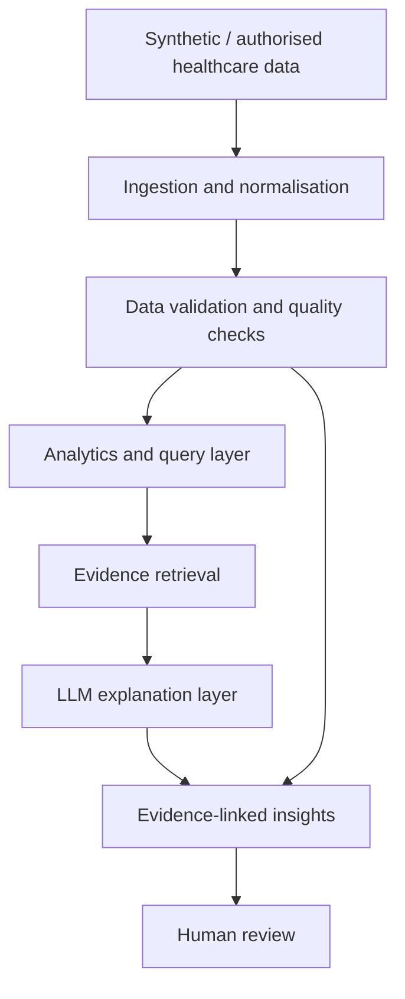

# MedTrace AI

> **Evidence-grounded healthcare intelligence for more trustworthy decisions.**

MedTrace AI is a hackathon prototype for **Challenge 3 — Exasol: Healthcare AI You Can Trust** at Healthcare Hackathon Bayern, Erlangen.

Healthcare information is often fragmented across clinical notes, medication records, laboratory results and other systems. MedTrace AI explores how these records can be brought together to surface useful insights while making supporting evidence, uncertainty and data-quality limitations visible.

**This is an experimental prototype. It is not a medical device, diagnostic system or substitute for professional clinical judgement. Use synthetic healthcare data only.**

## The problem

Healthcare data can be distributed across systems, incomplete, out of date, inconsistent or difficult to interpret. A generic chatbot does not solve these problems. A useful healthcare AI application must show where findings come from, identify gaps and contradictions, and communicate when evidence is insufficient.

## Our approach

MedTrace AI is designed around four principles:

1. **Connect** relevant structured and unstructured healthcare records.
2. **Validate** missing fields, duplicates, conflicting values and temporal inconsistencies.
3. **Explain** findings using retrieved source records and traceable references.
4. **Keep humans in control** by showing evidence and uncertainty for human review.

### Intended demonstration

A user asks:

> "Summarise the available history for this patient. Which records appear inconsistent, and what information is missing?"

The prototype should retrieve relevant records, display source and date, flag data-quality issues, generate an evidence-linked explanation, state what cannot be concluded, and mark the output for human review. It does not generate diagnoses or treatment recommendations.

## Trust and safety principles

| Principle | Prototype behaviour |
|---|---|
| Evidence traceability | Factual findings link to source record IDs. |
| Uncertainty | Insufficient or ambiguous evidence is explicitly reported. |
| Data quality | Missing, duplicate and conflicting records are surfaced. |
| Human oversight | Outputs are informational and require human review. |
| Privacy | Use synthetic or properly authorised, de-identified data only. |
| Separation of concerns | Deterministic checks/calculations run in code or SQL, not delegated to an LLM. |

## Architecture



## Planned technology

| Layer | Initial direction | Possible hackathon extension |
|---|---|---|
| Language | Python | Python |
| Ingestion | CSV / pandas | Additional formats/connectors |
| Storage | SQLite for local prototype | Exasol Personal / team-selected database |
| Validation | Python and SQL rules | More comprehensive quality checks |
| Retrieval | Patient-scoped keyword baseline | Optional embedding-based retrieval |
| AI | Optional LLM API | Team-selected model and orchestration |
| Interface | CLI initially | Streamlit or React |
| Testing | pytest | Scenario-based evaluation |

The stack is intentionally flexible. Exasol Personal is a potential analytics foundation for structured healthcare data; the final integration depends on the team's chosen solution and available access.

## Repository structure

```text
medtrace-ai/
├── data/
│   ├── synthetic/       # Fictional CSVs, including unstructured notes
│   └── medtrace_synthetic.sqlite3
├── docs/                # Architecture and decision notes
├── src/
│   └── medtrace/        # Ingestion, validation, retrieval, generation, and demo
├── tests/               # Unit, pipeline, and scenario evaluation tests
├── pyproject.toml       # Python 3.12 package and pytest configuration
├── .env.example
├── .gitignore
├── LICENSE
├── README.md
└── requirements.txt
```

## Getting started

### Requirements
- Python 3.12
- Git
- VS Code or another Python IDE

### 1. Clone
```bash
git clone https://github.com/<your-github-username>/medtrace-ai.git
cd medtrace-ai
```

### 2. Create a virtual environment

**Windows PowerShell**
```powershell
py -3.12 -m venv .venv
.venv\Scripts\Activate.ps1
```

**macOS / Linux**
```bash
python3 -m venv .venv
source .venv/bin/activate
```

### 3. Install dependencies
```bash
python -m pip install --upgrade pip
pip install -r requirements.txt
pip install -e .
```

### 4. Configure environment
Export the environment variables listed in `.env.example` only for components
you use. Never commit `.env` files or API keys. Generation defaults to the local
mock provider; it makes no network requests unless
`LLM_PROVIDER=openai_compatible` is selected and an API key and model are
configured.

To opt into local semantic retrieval, install its optional dependency:

```bash
pip install -e ".[semantic]"
```

The sentence-transformers model is loaded only when `SentenceTransformerEmbedder`
is instantiated. The first use may download the selected model; the keyword
retriever has no model or network dependency.

### 5. Run
Run the ingestion and validation pipeline from the repository root:

```bash
python -m medtrace
```

By default, the command reads `data/synthetic/patients.csv`,
`data/synthetic/medications.csv`, and
`data/synthetic/laboratory_results.csv`, and
`data/synthetic/clinical_notes.csv`. It writes the validated snapshot to
`data/medtrace_synthetic.sqlite3` and prints a JSON validation report. Override
the paths when needed:

```bash
python -m medtrace --data-dir data/synthetic --database data/demo.sqlite3
```

The CSVs intentionally contain missing values, repeated record IDs, invalid
dates, overlapping medication records with contradictory statuses, and unknown
patient references. These rows appear in the report and are not inserted into
SQLite. Valid records are retained, and foreign keys prevent orphan medication
or laboratory rows. An empty medication `end_date` is accepted only for an
`active` medication, where it represents an open-ended interval.

Run the tests with:

```bash
python -m pytest
```

### Database queries

The tables are `patients`, `medications`, `laboratory_results`, and
`clinical_notes`. For example, join a laboratory result to its patient while
retaining the source and observation date:

```sql
SELECT
    patient.patient_id,
    result.result_id,
    result.test_name,
    result.value,
    result.unit,
    result.observation_date,
    result.source
FROM laboratory_results AS result
JOIN patients AS patient USING (patient_id)
ORDER BY patient.patient_id, result.observation_date;
```

To check medication references, join medications to patients:

```sql
SELECT
    medication.medication_id,
    patient.patient_id,
    medication.medication_name,
    medication.status,
    medication.source
FROM medications AS medication
JOIN patients AS patient USING (patient_id);
```

SQLite foreign-key enforcement is enabled on every application connection;
`PRAGMA foreign_key_check;` can be used to verify the stored database.

### Evidence retrieval

The retrieval foundation is in `src/medtrace/retrieval/`. Both retrievers load
evidence from SQLite with a `WHERE patient_id = ?` filter before ranking, so
records from other patients are not candidates. Evidence results include the
record ID, patient ID, type, content, source name, timestamp, and additional
date metadata. `max_records` limits the result count.

The keyword baseline is available without optional dependencies:

```python
from pathlib import Path

from medtrace.database import SQLiteDatabase
from medtrace.retrieval import KeywordRetriever

retriever = KeywordRetriever(
    SQLiteDatabase(Path("data/medtrace_synthetic.sqlite3")),
    max_records=5,
)
results = retriever.retrieve("SYN-P001", "blood glucose monitoring")
```

Keyword retrieval tokenizes query and evidence text and ranks records by the
fraction of distinct query terms found in the record. It is transparent and
fast, but it does not understand synonyms or equivalent phrasing.

Semantic retrieval is a separate, optional path. It converts the query and each
patient-scoped record into embedding vectors, then computes cosine similarity:
the dot product of two vectors divided by the product of their lengths. Similar
meanings can be close in vector space even when they use different words. The
returned score is cosine similarity; `min_similarity` can filter weak matches.
Use `SentenceTransformerEmbedder` with the optional `semantic` extra, or supply
another `TextEmbedder` implementation. Tests use a small fake embedder, so they
do not download a model.

These are not SQL analytics queries. SQL filters records by the exact patient
ID and fetches structured rows; Python ranks fetched content by lexical matches
or embedding similarity. Neither retrieval strategy generates a summary or
clinical conclusion.

### Evidence-grounded generation

The generation module accepts a patient ID and natural-language question,
retrieves evidence with the existing patient-scoped keyword retriever, and
passes a structured context (record ID, patient ID, type, source, timestamp,
and content) to an LLM provider. The response includes a cited summary, key
findings, the retrieved supporting evidence, conflicts, missing information,
uncertainty, an abstention flag, and `human_review_required=true`.

```python
from pathlib import Path

from medtrace.database import SQLiteDatabase
from medtrace.generation import (
    EvidenceGenerationPipeline,
    LLMSettings,
    create_provider,
)
from medtrace.retrieval import KeywordRetriever

database = SQLiteDatabase(Path("data/medtrace_synthetic.sqlite3"))
retriever = KeywordRetriever(database, max_records=5)
provider = create_provider(LLMSettings.from_environment())
pipeline = EvidenceGenerationPipeline(retriever, provider)
result = pipeline.answer(
    "SYN-P001",
    "What do the available records mention about glucose tracking?",
)
print(result.to_dict())
```

Configure the opt-in OpenAI-compatible provider with `LLM_PROVIDER`,
`LLM_API_KEY`, and `LLM_MODEL`; `LLM_BASE_URL` and `LLM_TIMEOUT_SECONDS` can
also be configured. Credentials are read from the process environment and are
never included in logs or generated results. The HTTP adapter uses Python's
standard library. Provider construction and the mock provider make no network
requests. Tests use mock responses only.

The provider receives instructions to use only retrieved evidence, cite record
IDs for factual statements, identify gaps and conflicts, abstain if evidence is
insufficient, and avoid diagnoses, treatment recommendations, and clinical
decisions. The application validates that cited IDs came from the retrieved
patient-scoped records and rejects output missing required citations or
containing explicit diagnosis/action language. When retrieval returns no
records, the pipeline abstains without invoking a provider. All outputs require
human review; generation failures are surfaced rather than replaced with
plausible-looking content.

This is a hackathon prototype: prompts and output checks reduce risk but do not
establish clinical safety or guarantee that a language model is correct.

### End-to-end demo and deterministic evaluation

Run the complete local demonstration from the repository root:

```bash
python -m medtrace.demo
```

The command ingests and validates all files in `data/synthetic/`, writes valid
records to a temporary SQLite database, and runs five fixed scenarios with
mock responses: a supported answer, conflicting allergy records, missing
fatigue-duration information, no relevant records, and a request for another
patient's information. It prints each structured answer and its deterministic
evaluation checks as JSON. The temporary database is removed when the command
finishes; the committed/demo database is not overwritten. The default demo
makes no network calls and downloads no models.

To try a patient ID and question through the same local pipeline:

```bash
python -m medtrace.demo --patient-id SYN-P001 --question "Was blood glucose tracking mentioned?"
```

The custom-question path uses the safe default mock, which abstains rather than
pretending to answer arbitrary questions. It still displays any patient-scoped
retrieved evidence and runs the same structural checks.

Example excerpt for the supported scenario:

```json
{
  "summary": "The note says blood glucose is tracked at home and routine monitoring was discussed. [SYN-N001]",
  "summary_source_ids": ["SYN-N001"],
  "supporting_evidence": [
    {
      "record_id": "SYN-N001",
      "source": "synthetic-clinical-notes-a",
      "timestamp": "2025-04-15T10:30:00Z"
    }
  ],
  "missing_information": [],
  "uncertainty": {
    "text": "The note does not provide additional tracking details. [SYN-N001]",
    "source_ids": ["SYN-N001"]
  },
  "human_review_required": true,
  "abstained": false,
  "evaluation": {"passed": true}
}
```

The evaluation checks that cited and displayed record IDs exist in the
retrieved set, retrieved/cited evidence belongs to the requested patient,
abstention matches the scenario, expected conflicts and missing information
are reported, and human review is required. These deterministic checks test
structure, provenance, isolation, and expected demo behavior only. They do not
prove clinical safety or factual correctness.

### Phase 5: AI Cross-Examiner

`src/medtrace/cross_examiner.py` independently extracts factual-looking
sentences and clauses from the original summary, findings, conflicts, and
missing-information statements, then compares them to the retrieved records.
The original response and its citations are retained. The Cross-Examiner does
not call an LLM: it uses conservative lexical matching and a narrow explicit
allergy-polarity rule. It marks each claim `supported`, `contradicted`, or
`insufficient_evidence`, reports supporting and contradicting record IDs, and
requires human review. The demo runs it on the conflicting-allergy scenario
and prints `original_generated_answer` beside `cross_examination`.

Example excerpt:

```json
{
  "original_generated_answer": {
    "summary": "The patient has no known allergies. [SYN-P001]",
    "summary_source_ids": ["SYN-P001"]
  },
  "cross_examination": {
    "claims": [
      {
        "claim_text": "The patient has no known allergies.",
        "cited_source_ids": ["SYN-P001"],
        "supporting_source_ids": ["SYN-P001"],
        "contradicting_source_ids": ["SYN-N002"],
        "verification_status": "contradicted",
        "human_review_required": true
      }
    ],
    "human_review_required": true
  }
}
```

This illustrates a record-level disagreement: the patient registry supports
the generated wording, while a retrieved note records seasonal allergies.
The verifier does not decide which record is correct. Its lexical rules may
miss paraphrases, misunderstand negation or context, or produce false matches;
`supported` is not proof of factual correctness. This synthetic-data research
prototype has no clinical validation and is not a clinical decision system.

### Implementation notes

- `ingestion.py` reads CSVs with pandas and carries the original CSV line number
  into each in-memory row so validation findings point back to their source.
- `validation.py` performs deterministic checks before persistence. A
  medication-status conflict means records for the same patient and medication
  have different statuses during overlapping date intervals. An active record
  with no end date has an open-ended interval.
- `database.py` owns SQLite connections, schema creation, transactions, and
  parameterized inserts. The patient table is the parent table; medication and
  laboratory tables reference it with foreign keys.
- `pipeline.py` connects the stages. Any row with an error is excluded from the
  database snapshot, while its structured issue remains in the JSON report.
  The snapshot is replaced as a transaction, and database failures are raised
  rather than converted into a success-shaped result.
- `models.py` defines typed issue, evidence, and pipeline results. Optional
  semantic retrieval uses embeddings only to rank evidence; the generation
  module uses a provider abstraction and does not change retrieval behavior.
- `demo.py` runs ingestion, validation, patient-scoped retrieval, mock
  generation, and scenario evaluation without overwriting the repository
  database. `evaluation.py` checks evidence IDs, patient isolation, abstention,
  conflict/missing-information expectations, and the human-review flag.
- `cross_examiner.py` performs deterministic, claim-level evidence comparisons;
  it retains the original response and only reports sources from the retrieved
  patient evidence.

## Evaluation plan

Use synthetic test scenarios to evaluate:
- Whether the correct supporting records are retrieved.
- Whether findings link to source IDs.
- Whether deliberately introduced missing/conflicting data is detected.
- Whether unsupported claims are avoided.
- Whether insufficient evidence is clearly communicated.
- Whether a human reviewer can understand why a finding was produced.

A strong demo should show both a supported finding and a case where the system correctly declines to draw a conclusion.

## Roadmap

- [ ] Confirm target user and exact problem with the hackathon team.
- [ ] Define the MVP and data model.
- [ ] Implement ingestion and normalisation.
- [ ] Add data-quality and conflict checks.
- [ ] Integrate Exasol if selected and available.
- [ ] Implement evidence retrieval.
- [ ] Add an LLM explanation layer with source references.
- [ ] Build a simple interface.
- [ ] Test missing, conflicting and insufficient-evidence scenarios.
- [ ] Prepare a reproducible end-to-end demo.

## Team

Add final team members and roles here.

## Acknowledgement

Built for **Challenge 3 — Exasol: Healthcare AI You Can Trust**, Healthcare Hackathon Bayern, Medical Valley EMN.

Challenge brief: https://hackathon.medical-valley-emn.de/healthcare-ai-you-can-trust/

## Disclaimer

This project is an experimental hackathon prototype for educational and demonstration purposes. It does not provide medical advice, diagnosis, triage or treatment recommendations. All outputs require appropriate human review. Use synthetic healthcare data only.
